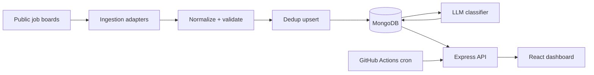

# FirstStep AI

**India's Early-Career Opportunity Intelligence Engine**  
Tagline: *Your next opportunity starts here.*

> Upgrade status (2026-11-17): India geography is enforced separately from early-career signals; see `docs/ENGINEERING_AUDIT.md` and `FINAL_REPORT.md`.

India’s fresher and internship opportunity intelligence platform.

FirstStep AI ingests public job postings from permitted employer boards (Greenhouse, Ashby, SmartRecruiters, and Lever when available), normalizes and deduplicates them, classifies role / city / experience with an LLM, and serves a searchable React dashboard.

## Architecture



## Stack

| Layer | Technology |
| --- | --- |
| Frontend | React, Vite, Tailwind CSS, React Router, Axios, Lucide |
| Backend | Node.js 20+, Express, Mongoose, Zod |
| Database | MongoDB (Atlas recommended; local/memory fallback for development) |
| AI | Gemini Flash (primary) / Groq (optional) / mock (tests) |
| Scheduler | GitHub Actions daily cron (00:30 UTC / 06:00 IST) |

## Repository layout

```
firststep AI/
  frontend/          React app
  backend/           Express API + ingestion + classification
  docs/              Architecture and methodology docs
  evaluation/        50-post human evaluation artifacts
  .github/workflows/ Daily refresh
```

## Quick start

### 1. Install

```bash
cd "firststep AI"
npm run install:all
```

### 2. Configure environment

Copy `.env.example` to `.env` and set:

- `MONGODB_URI` — MongoDB Atlas connection string (preferred)
- `GEMINI_API_KEY` — for classification
- `GROQ_API_KEY` — optional
- `ADMIN_API_KEY` — protects admin refresh endpoints

MongoDB should be **Atlas** (`MONGODB_URI` + `MONGODB_DB_NAME=firststep_ai`). Do not use the inkstall local Compass instance. Optional local helper remains behind `USE_LOCAL_MONGO=1` only.

### 3. Ingest jobs

```bash
cd backend
npm run ingest          # requires reachable MONGODB_URI
# or
npm run ingest:memory   # ephemeral/persistent local mongod via mongodb-memory-server
```

### 4. Classify jobs

```bash
cd backend
npm run classify
# or
CLASSIFY_LIMIT=200 npm run classify:memory
```

### 5. Run API + UI

```bash
# terminal 1
cd backend && npm run dev
# or: npm run dev:stack   # memory mongo + auto-ingest if <200 jobs + API

# terminal 2
cd frontend && npm run dev
```

Open http://localhost:5173

## Adding employers

Edit `backend/src/services/ingestion/sourceRegistry.js`.

Only add board IDs after verifying the public endpoint returns HTTP 200:

- Greenhouse: `https://boards-api.greenhouse.io/v1/boards/{token}/jobs`
- Ashby: `https://api.ashbyhq.com/posting-api/job-board/{token}`
- SmartRecruiters: `https://api.smartrecruiters.com/v1/companies/{id}/postings`
- Lever: `https://api.lever.co/v0/postings/{site}?mode=json`

Set `enabled: true` only for verified boards.

## Admin refresh

```bash
curl -X POST http://localhost:5050/api/admin/ingestion/run \
  -H "x-admin-api-key: $ADMIN_API_KEY"

curl -X POST http://localhost:5050/api/admin/classification/run \
  -H "x-admin-api-key: $ADMIN_API_KEY" \
  -H "Content-Type: application/json" \
  -d '{"limit":200}'
```

## Tests

```bash
cd backend && npm test
```

## Evaluation

```bash
cd backend
npm run export:evaluation   # writes evaluation/benchmark.csv (AI columns filled, human blank)
# manually label 50 rows
npm run import:evaluation   # computes accuracy only from labeled rows
```

See `evaluation/README.md`.

## Daily scheduling

`.github/workflows/daily-ingestion.yml` runs at **00:30 UTC (06:00 IST)**.

Required GitHub secrets:

- `FIRSTSTEP_API_BASE_URL`
- `FIRSTSTEP_ADMIN_API_KEY`

## Deployment

- Frontend: Vercel (`frontend/`, set `VITE_API_BASE_URL`)
- Backend: Render (`render.yaml`)
- Database: MongoDB Atlas

Do not claim a live deployment until URLs are verified.

## Documentation

- [Architecture](docs/ARCHITECTURE.md)
- [Data sources](docs/DATA_SOURCES.md)
- [AI classification](docs/AI_CLASSIFICATION.md)
- [Deduplication](docs/DEDUPLICATION.md)
- [Failure handling](docs/FAILURE_HANDLING.md)
- [Cost methodology](docs/COST_METHODOLOGY.md)
- [Deployment](docs/DEPLOYMENT.md)

## Honest limitations

- Lever boards in the initial registry returned 404 during verification; the Lever adapter remains implemented but disabled until live board IDs are confirmed.
- Local Windows MongoDB service may require admin rights; use Atlas or `npm run ingest:memory` / `dev:stack`.
- Accuracy percentages are not final until 50 posts are human-labeled.
- LLM costs are estimated from logged tokens × configured $/MTok prices.


## Upgrade reports

- [FINAL_REPORT.md](./FINAL_REPORT.md)
- [Engineering audit](./docs/ENGINEERING_AUDIT.md)
- [Security](./docs/SECURITY.md)

